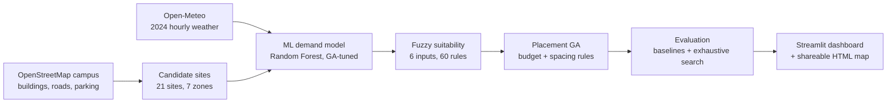

# Smart EV Charging Station Planning for VIT-AP University (ML · Fuzzy Logic · Genetic Algorithm)

[]()
[]()
[](LICENSE)

> University project — VIT-AP University, Amaravati, Andhra Pradesh, India

A hybrid **Machine Learning → Fuzzy Logic → Genetic Algorithm** pipeline that decides **where to build EV charging stations on the VIT-AP campus**. It works on the real campus layout from OpenStreetMap, predicts charging demand, scores every candidate site, and picks the best set of stations under a budget, then checks that answer against an exhaustive search.

---

## Table of Contents

1. [Problem Statement](#problem-statement)
2. [Objectives](#objectives)
3. [Architecture](#architecture)
4. [Tech Stack](#tech-stack)
5. [Features](#features)
6. [Installation](#installation)
7. [Running the Project](#running-the-project)
8. [Implementation Details](#implementation-details)
9. [Results](#results)
10. [Data and Provenance](#data-and-provenance)
11. [Project Structure](#project-structure)
12. [Testing](#testing)
13. [Limitations and Future Work](#limitations-and-future-work)
14. [Acknowledgments](#acknowledgments)
15. [License](#license)

---

## Problem Statement

More students and staff at VIT-AP are moving to electric vehicles, and they need somewhere to charge them on campus. Choosing where to put the first chargers is not obvious:

- **Budget is limited.** Each site costs ₹47–228 lakh (land, construction, grid connection) against a ₹300 lakh budget.
- **Many factors conflict.** A site with high demand may be expensive; a cheap site may be far from where people park.
- **Spacing matters.** Stations placed too close together serve the same people; too far apart leaves areas uncovered.

Choosing by hand cannot weigh all of these at once. This project combines three techniques, each suited to one part of the problem.

## Objectives

1. **Predict demand** — estimate hourly charging demand at each candidate site with a machine learning model.
2. **Score suitability** — rate each site from 0 to 1 using fuzzy logic over six factors.
3. **Optimise placement** — choose the best set of sites within budget and spacing rules using a genetic algorithm.
4. **Prove the result** — compare the GA's plan with simpler methods and with an exhaustive search.
5. **Stay transparent** — label every value as real, derived or synthetic.

## Architecture



| Stage | Trained? | What it does |
|-------|----------|--------------|
| **ML** | Yes | A Random Forest learns hourly demand from time, weather, zone and nearby points of interest. A small GA searches its settings. |
| **Fuzzy** | No | Expert-written IF–THEN rules turn six factors into one suitability score. |
| **GA** | No (optimiser) | Searches combinations of sites and returns the best plan that satisfies every hard rule. |

## Tech Stack

| Area | Tools |
|------|-------|
| Language | Python 3.10+ |
| Data | pandas, NumPy, PyYAML |
| Geospatial | GeoPandas, Shapely, pyproj, OpenStreetMap (Overpass API) |
| Machine learning | scikit-learn (Random Forest), joblib |
| Fuzzy logic | scikit-fuzzy (Mamdani inference) |
| Optimisation | Genetic algorithm implemented from scratch with NumPy |
| Visualisation | Streamlit, Folium, streamlit-folium, Plotly, Esri satellite tiles |
| Testing | pytest |

## Features

- **Real campus layout:** candidate sites and zones are built from OpenStreetMap features inside the official VIT-AP campus boundary (OSM way 750542244).
- **GA-tuned demand model:** a genetic algorithm searches Random Forest settings on a time-based validation window.
- **Complete fuzzy rule base:** 35 detailed rules plus 25 covering rules guarantee every site gets a score.
- **Hard constraints:** plans that break the budget or minimum spacing are never returned.
- **Verified optimum:** with 21 sites there are only 1,330 possible 3-station plans, so the evaluation checks all of them.
- **Data provenance:** every dataset carries a `data_provenance` column labelling each field `REAL`, `DERIVED`, `SYNTHETIC` or `META`.
- **Interactive dashboard:** satellite map with OSM buildings, zones, candidate sites and chosen stations, plus rankings, cost breakdown, evaluation and model accuracy.
- **One-command pipeline:** `python run_pipeline.py all`.

## Installation

```bash
git clone https://github.com/Sai-koushik-18/ev-charging-site-optimizer-ml-fuzzy-ga.git
cd ev-charging-site-optimizer-ml-fuzzy-ga

python -m venv .venv
# Windows
.venv\Scripts\activate
# macOS / Linux
source .venv/bin/activate

pip install -r requirements.txt
pip install -r requirements-dev.txt   # optional: tests and linting
```

No API keys are needed. The OpenChargeMap loader in the legacy pipeline reads an optional `OCM_API_KEY` environment variable; never commit a key to the repository.

## Running the Project

**See the results straight away** — the repository includes the pipeline outputs:

```bash
streamlit run demo_dashboard.py      # or: make dashboard
```

Then open http://localhost:8501. You can also open `outputs/maps/campus_map.html` directly in a browser.

**Rebuild everything:**

```bash
python run_pipeline.py all           # or: make all  (about 3–5 minutes)
```

**Run one stage at a time** (each stage reads the previous stage's output):

| Command | What it does | Main output |
|---------|--------------|-------------|
| `python run_pipeline.py candidates` | Build zones and candidate sites from the OSM extract | `data/processed/candidates_campus.csv` |
| `python run_pipeline.py ml` | Generate demand history, GA-tune and train the model | `data/processed/candidates_campus_demand.csv`, `outputs/ml_results/metrics.json` |
| `python run_pipeline.py fuzzy` | Score every site | `data/processed/candidates_demo_fuzzy_scored.csv` |
| `python run_pipeline.py ga` | Select the stations | `data/processed/ga_solution_demo.csv`, `outputs/ga_results/` |
| `python run_pipeline.py evaluate` | Compare with baselines and exhaustive search | `outputs/evaluation/` |
| `python run_pipeline.py visualize` | Write the shareable map | `outputs/maps/campus_map.html` |

The OSM extract (`data/raw/osm/campus_osm.json`) and 2024 weather are included, so the pipeline runs offline. Add `--force-refresh` to the `candidates` stage to download the latest OSM data.

## Implementation Details

### 1. Candidate sites — `src/pipeline/campus_pipeline.py`

- `fetch_osm()` downloads every OSM feature around the campus once and caches it.
- `build_zones()` draws seven zones around named OSM buildings: academic (AB-1, AB-2, CB), men's hostels (MH-1 to MH-7), ladies' hostels (LH-1 to LH-3), commercial (Food Street, Rock Plaza), sports (all mapped pitches), entry points (where roads cross the campus boundary) and the rest of the campus.
- `build_sites()` creates candidate sites in three ways: the 2 mapped parking lots, the point on the nearest drivable road to each named building's edge, and the campus entry points. Sites closer than 60 m are merged.
- `build_candidates()` adds features using `src/data/candidate_generator.py`: zone, land-cost tier, distance to the grid connection point, POI attractiveness, distance to entry points, and costs.

### 2. ML demand model — `src/ml/demand_predictor.py`, `src/ml/ga_tuner.py`

- `src/data/synthetic_generator.py` generates hourly demand for each site for 2024 from zone base rates, time-of-day and weekday patterns, exams and holidays, and real Open-Meteo temperatures.
- `EVChargingDemandPredictor` engineers features (hour, day, month, weekend, holiday, exam period, temperature, humidity, rain, one-hot zone, POI score) and trains a Random Forest.
- The split is **temporal**: train on the first 80% of the year, test on the last 20%, so the model is always tested on future hours.
- `tune_random_forest_ga()` evolves Random Forest settings (trees, depth, leaf size, features per split) with a GA, scoring each on a validation window taken from the training period only.
- Each site's predicted annual demand becomes a 0–100 **demand index** relative to the busiest site.

### 3. Fuzzy suitability — `src/fuzzy/scorer.py`, `config/fuzzy_config.yaml`

- Six inputs: demand index, traffic accessibility, grid connection cost, land-cost tier, POI attractiveness, existing chargers nearby.
- Each input has overlapping triangular/trapezoidal membership functions (for example *low*, *medium*, *high*).
- **Mamdani inference** fires all matching rules; **centroid defuzzification** gives one score from 0 to 1.
- 35 detailed rules capture expert judgement; 25 covering rules on demand × traffic ensure at least one rule always fires.

### 4. Placement GA — `src/ga/optimizer.py`

- **Chromosome:** one bit per site (1 = build here), always exactly K ones (a repair step enforces this).
- **Operators:** tournament selection (size 3), uniform crossover (0.8), bit-flip mutation (0.3), elitism (best 2 kept).
- **Fitness:** 35% demand coverage + 25% spatial coverage (sites within 250 m of a station) + 25% cost efficiency − 15% clustering penalty.
- **Hard rules:** total cost ≤ ₹300 lakh, stations ≥ 300 m apart, all costs known. Any violation gives fitness 0.
- The pipeline runs **10 independent GA runs** and keeps the best, which avoids a single run stalling on a local optimum.

### 5. Evaluation — `src/evaluation/evaluate.py`

Every method picks the same number of stations under the same rules and is scored with the GA's own fitness function: greedy by fuzzy score, greedy by ML demand, greedy by lowest cost, the average of 1,000 random plans, and an exhaustive search of every possible plan.

### 6. Pipeline and dashboard

- `run_pipeline.py` is the command-line entry point; each stage is a function in `src/pipeline/campus_pipeline.py`.
- `demo_dashboard.py` is the Streamlit app. It reloads data whenever the pipeline rewrites a file.
- `src/visualization/campus_map.py` writes a standalone HTML map.

## Results

Current demo configuration (`config/ga_config_demo.yaml`): 3 stations, ₹300 lakh budget, 300 m minimum spacing.

**Selected stations**

| Rank | Site | Zone | Cost |
|------|------|------|------|
| 1 | Roadside near AB-2 | Academic | ₹47.2 L |
| 2 | Roadside near MH-2 | Men's hostels | ₹50.1 L |
| 3 | Roadside near Sports Triangle 2 | Ladies' hostels | ₹51.0 L |

Total ₹148.3 lakh, leaving ₹151.7 lakh. The closest pair of stations is 344 m apart; 95% of candidate sites lie within 250 m of a station. Up to 4 stations fit the same budget and spacing.

**GA vs other methods** (fitness, higher is better)

| Method | Fitness |
|--------|---------|
| GA, best of 10 runs | **0.518** |
| Exhaustive search over all 1,330 plans (true optimum) | 0.518 |
| Cheapest sites first | 0.506 |
| Top fuzzy score / highest ML demand first | 0.482 |
| Random valid placement (mean) | 0.458 |

Only 188 of the 1,330 plans meet the budget and spacing rules; the GA returns the best of them.

**Demand model** (tested on the last 20% of 2024)

| Model | RMSE (kWh/h) | R² |
|-------|--------------|----|
| Average by site, hour and weekend | 0.489 | — |
| Random Forest, default settings | 0.485 | 0.925 |
| Random Forest, GA-tuned | **0.413** | **0.945** |

The model is trained on synthetic demand, so these figures show the method works; they are not a measure of real-world accuracy.

## Data and Provenance

| Data | Source | Label |
|------|--------|-------|
| Campus boundary, buildings, roads, parking | OpenStreetMap | REAL |
| Hourly weather, 2024 | Open-Meteo | REAL |
| Zones and candidate sites | Built from OSM geometry | DERIVED |
| Charging demand history | Statistical model | SYNTHETIC |
| Land, construction and grid costs | Rates in `config/settings.yaml` | SYNTHETIC |
| Grid connection point | OSM campus power building (no transformer is mapped) | SYNTHETIC assumption |
| Existing chargers nearby | Set to 0 (OpenChargeMap unavailable) | SYNTHETIC assumption |

## Project Structure

```
├── config/
│   ├── settings.yaml            # study area, costs, demand model, zone tiers
│   ├── fuzzy_config.yaml        # membership functions and 60 rules
│   ├── ga_config_demo.yaml      # GA used by the pipeline
│   ├── ga_config.yaml           # original GA settings, kept for reference
│   └── data_sources.yaml        # data source definitions
├── data/
│   ├── raw/osm/                 # OSM campus extract and exported layers
│   ├── raw/weather/             # Open-Meteo 2024 weather
│   ├── external/                # zones, grid point, EV adoption curve
│   └── processed/               # candidate sites, scores, GA solution
├── outputs/                     # evaluation, ML metrics, GA history, HTML map
├── src/
│   ├── data/                    # loaders, candidate features, synthetic demand, provenance
│   ├── ml/                      # demand predictor and GA hyperparameter tuner
│   ├── fuzzy/                   # fuzzy suitability scorer
│   ├── ga/                      # placement genetic algorithm
│   ├── evaluation/              # GA vs baselines and exhaustive search
│   ├── visualization/           # standalone campus map
│   └── pipeline/                # campus pipeline stages + legacy data prep
├── tests/                       # pytest suite
├── run_pipeline.py              # command-line entry point
├── demo_dashboard.py            # Streamlit dashboard
├── Makefile
├── requirements.txt
└── requirements-dev.txt
```

## Testing

```bash
python -m pytest            # or: make test (adds coverage)
```

36 tests cover: fuzzy rule coverage and monotonic behaviour, land-tier mapping and the demand-index path; GA hard constraints and agreement with exhaustive search; the GA tuner; the demand predictor; the OSM loader; and candidate provenance.

## Limitations and Future Work

| Limitation | Next step |
|------------|-----------|
| The ML model is trained on synthetic demand | Validate on real charging sessions (e.g. Caltech's public ACN-Data) |
| Costs and the grid connection point are assumptions | Use transformer locations and cost records from the campus estates office |
| Fuzzy rules are written by hand | Collect suitability ratings for example sites and tune the rules with a GA (genetic-fuzzy system) |
| Zones come from OSM building positions, not an official plan | Align with the VIT-AP master plan |
| Existing chargers are unknown | Add an OpenChargeMap key or a campus survey |

The original data pipeline (`python run_pipeline.py data-prep` / `validate`) is kept for reference; the campus pipeline above supersedes it.

## Acknowledgments

- © OpenStreetMap contributors (ODbL) — campus buildings, roads and boundary
- Open-Meteo — historical weather
- Esri World Imagery and World Street Map — dashboard base maps
- NITI Aayog / SIAM — EV adoption reference figures

## License

MIT License — see [LICENSE](LICENSE).
